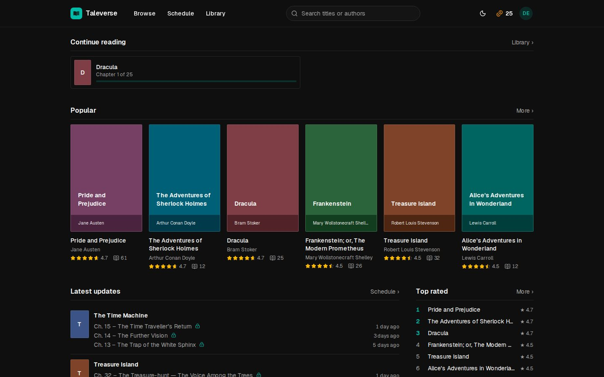
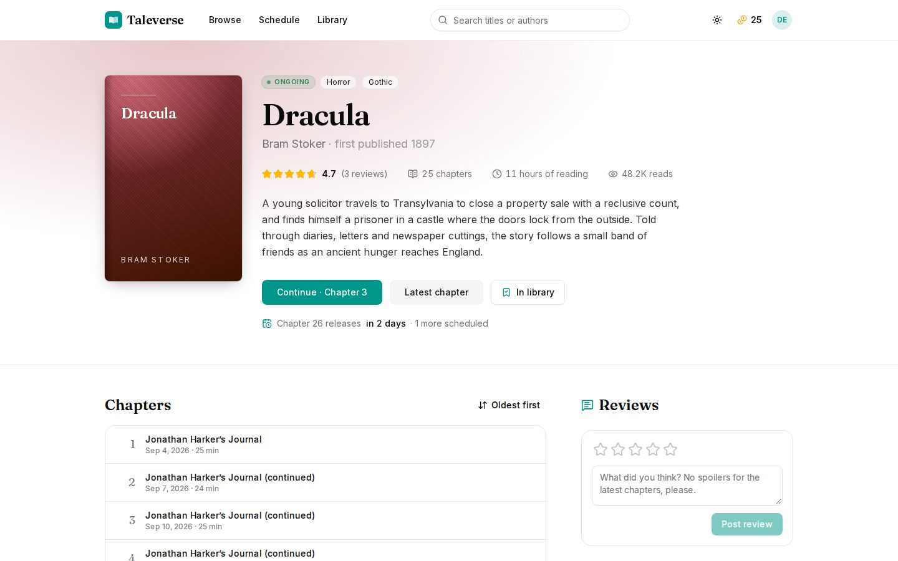
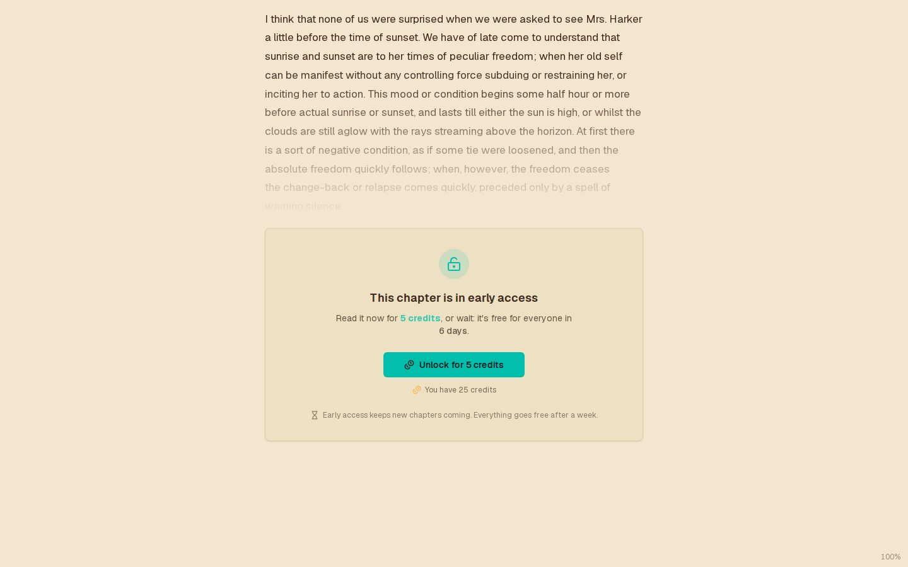
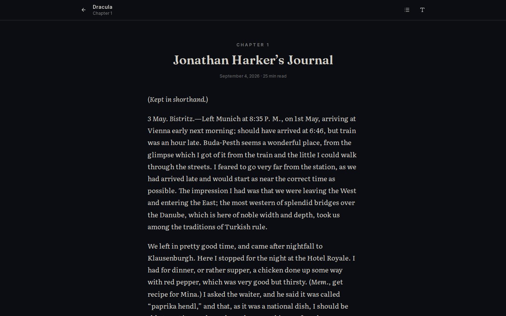

# Taleverse

**Serial fiction, one chapter at a time.** A web-novel platform: the back catalogue is free, the newest chapters are early access for credits, and every chapter goes free for everyone a week after release.



> Try it without an account: **Try as a reader** signs you into a shared demo account with 25 credits; **Try as an admin** lets you write and schedule chapters. Payments run in Stripe test mode (`4242 4242 4242 4242`). Demo data resets nightly.

## The two-minute tour

1. **Read.** Open any novel and start chapter 1. The reader is server-rendered, with a choice of typeface, size, spacing, width and paper / sepia / night themes. Settings live in a cookie, so they render on the server with no flash.
2. **Hit the paywall.** The newest chapters of ongoing novels are in early access. You see a short preview, the price, and when the chapter goes free.
3. **Unlock.** As the demo reader, spend 5 credits. Your balance updates and the chapter opens.
4. **Top up.** Buy a credit pack through Stripe Checkout; the webhook credits your account exactly once.
5. **Publish.** Switch to the demo admin, open a chapter, edit it in the block editor, and schedule its release and early-access window. It appears on the public release schedule.

Along the way: a library with reading progress and "Continue reading", ratings and reviews, chapter comments, genre pages, search, and dark mode.

| Novel page | Early-access paywall |
|---|---|
|  |  |
| **Reader (night theme)** | **Admin chapter editor** |
|  |  |

## Stack

Next.js 16 (App Router, Server Components, Server Actions) · React 19 · TypeScript · Prisma 7 on PostgreSQL · Clerk · Stripe Checkout · Tailwind CSS 4 + shadcn/ui · BlockNote · Vitest · GitHub Actions

## Engineering notes

The parts most worth reading in the code:

**A credit ledger, not a balance column** ([`src/lib/credits.ts`](src/lib/credits.ts)). Credits are an append-only `CreditLedgerEntry` table, and a balance is `SUM(delta)`. Every write carries a unique idempotency key (`stripe:<session>`, `unlock:<user>:<chapter>`), so a retried webhook or a double-clicked button can't create a second entry. Unlocking runs in a transaction that first takes a row lock on the user (`SELECT … FOR UPDATE`), so concurrent unlocks serialize and the balance can't go negative. [Integration tests](src/lib/credits.test.ts) fire parallel unlocks at a real Postgres to prove it.

**Payments that can't double-credit** ([`src/lib/payments.ts`](src/lib/payments.ts)). Checkout Sessions are fulfilled both by the [signature-verified webhook](src/app/api/webhooks/stripe/route.ts) and on the success redirect, whichever arrives first. The ledger's idempotency key makes the second a no-op. The success redirect only fulfils a session that belongs to the signed-in user.

**Access rules in one pure function** ([`src/lib/access.ts`](src/lib/access.ts)). A chapter is *draft → scheduled → early access → free*, derived from two timestamps (`publishedAt`, `freeAt`) at query time. No cron job has to flip a flag, so nothing can fail to fire. The chapter list, the reader and the unlock action all use the same function.

**Paywalled content never leaves the server.** A locked chapter's page only receives a short preview ([`previewBlocks`](src/lib/blocks.ts)), not the full chapter hidden behind CSS. Chapters are stored as BlockNote JSON and rendered by a [small server-side renderer](src/components/reader/ChapterBody.tsx) that allows only known block types, escapes all text and drops `javascript:` links. Readers get semantic HTML with no `dangerouslySetInnerHTML` and no editor JavaScript.

**Authorization at the data layer.** Every server action derives the user from the session ([`src/lib/auth.ts`](src/lib/auth.ts)) and never trusts a client-supplied user ID. Admin actions check the role. `proxy.ts` only attaches auth state; it isn't relied on for authorization (see CVE-2025-29927).

**One-click demo accounts** ([`src/app/actions/demo.ts`](src/app/actions/demo.ts)). The server finds or creates the shared Clerk user, then issues a short-lived sign-in token, which the client exchanges for a session (`signIn.ticket()`). A [nightly reset](src/lib/seed/index.ts) (Vercel Cron → `/api/cron/demo-reset`) restores the catalogue, regenerates release dates relative to now so early-access chapters are always live, and wipes demo activity, while keeping real users' purchases.

**Real content.** Seven public-domain novels from Project Gutenberg, split into 191 chapters by a [tested importer](src/lib/seed/gutenberg.ts) that strips boilerplate, skips tables of contents, keeps verse line breaks and turns `_underscores_` into italics. Covers are generated typographically from a per-novel hue.

**Works with zero config.** Without Clerk keys the app runs read-only (browse and read free chapters). Without Stripe keys, purchases go through a simulated provider that uses the same ledger path (development only). CI builds in exactly that mode.

More background is in [`docs/DECISIONS.md`](docs/DECISIONS.md).

## Run it locally

Requires Node 22+, pnpm and Docker.

```bash
pnpm install
pnpm db:up          # Postgres 17 in Docker (plus a separate test database)
pnpm db:deploy      # apply migrations
pnpm db:seed        # 7 novels, 191 chapters, readers, reviews
pnpm dev            # http://localhost:3000
```

That gives you the read-only site. To turn everything on:

- **Accounts and demo buttons:** `npx clerk@latest init` writes temporary Clerk dev keys to `.env.local` (no Clerk account needed). Restart `pnpm dev`.
- **Or skip Clerk entirely:** `DEV_AS=reader pnpm dev` (or `DEV_AS=admin`) signs every request in as a local dev account.
- **Real Stripe test payments:** set `STRIPE_SECRET_KEY` and run `stripe listen --forward-to localhost:3000/api/webhooks/stripe` for `STRIPE_WEBHOOK_SECRET`.

All variables are documented in [`docs/ENVIRONMENT.md`](docs/ENVIRONMENT.md).

| Command | What it does |
|---|---|
| `pnpm test` | Unit tests plus Postgres integration tests (ledger concurrency, demo reset) |
| `pnpm test:e2e` | Playwright: guest paywall, reader unlock / purchase / library / review / comment, admin scheduling, against its own database |
| `pnpm lint` / `pnpm typecheck` | ESLint and TypeScript |
| `pnpm demo:reset` | Restore the catalogue and demo accounts |
| `pnpm import:gutenberg` | Re-download and re-split the seed novels |

## Deploying

Built for Vercel + Neon: set `DATABASE_URL`, the Clerk and Stripe keys, `APP_URL` and `CRON_SECRET`; `vercel.json` schedules the nightly demo reset. Run `pnpm db:deploy && pnpm db:seed` once against the production database.

## Credits

Novel texts are in the public domain and come from [Project Gutenberg](https://www.gutenberg.org). Taleverse is not affiliated with Project Gutenberg.
